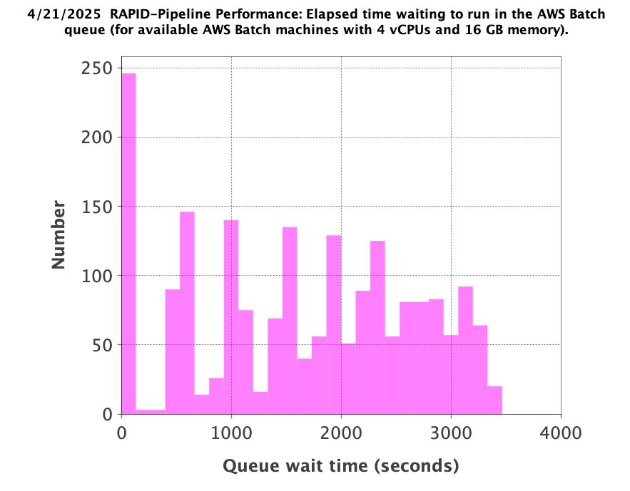
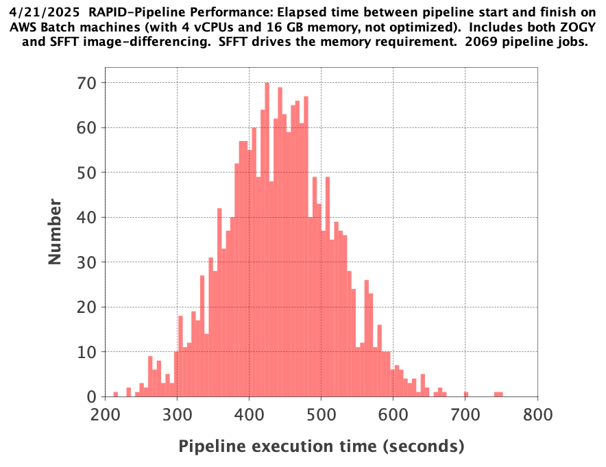

RAPID Pipeline Execution
####################################################

Overview
************************************

A RAPID processing request runs eighteen stages, in order.  Normally the
:doc:`Virtual Pipeline Operator (VPO) <vpo>` runs them all, either for one processing date or
in its automatic open loop.  This page describes running the stages by hand, which is useful
for testing a change, rerunning a stage, or processing a request outside the VPO.  It uses the
same stages, in the same order, with the same scripts and environment as the VPO.

Follow the stages in order and do not omit any, since each relies on all the previous ones.

.. list-table::
   :header-rows: 1
   :widths: 6 50 44

   * - #
     - Script (in ``/code/pipeline``)
     - What it does
   * - 1
     - ``launchBunchOfReferenceImagePipelines.py``
     - Launches the reference-image pipelines (``ppid = 12``) as AWS Batch jobs.
   * - 2
     - *wait*
     - Wait for those AWS Batch jobs to finish.
   * - 3
     - ``parallelRegisterCompletedJobsInDB.py``
     - Registers reference-image pipeline metadata in the operations database.
   * - 4
     - ``launchSciencePipelinesForDateTimeRangeWithRefImageWindow.py``
     - Launches the science pipelines (``ppid = 15``) as AWS Batch jobs.
   * - 5
     - *wait*
     - Wait for those AWS Batch jobs to finish.
   * - 6
     - ``parallelRegisterCompletedJobsInDB.py``
     - Registers science-pipeline metadata in the operations database.
   * - 7
     - ``awsBatchSubmitJobs_launchPostProcPipelinesForProcDate.py``
     - Launches the post-processing pipelines (``ppid = 17``) as AWS Batch jobs.
   * - 8
     - *wait*
     - Wait for those AWS Batch jobs to finish.
   * - 9
     - ``parallelRegisterCompletedJobsInDBAfterPostProc.py``
     - Registers post-processing pipeline metadata in the operations database.
   * - 10
     - ``loadPSFCatIntoDBSourcesTable.py``
     - Loads the PhotUtils PSF-fit catalogs into the ``Sources`` child tables.
   * - 11
     - ``loadSECatIntoDBSourcesTable.py``
     - Loads the SExtractor catalogs into the ``XSources`` child tables.
   * - 12
     - ``crossMatchSources.py``
     - Cross-matches Sources into ``AstroObjects_<field>`` and ``Merges_<field>``.
   * - 13
     - ``crossMatchXSources.py``
     - Cross-matches XSources into ``XAstroObjects_<field>`` and ``XMerges_<field>``.
   * - 14
     - ``computeStatisticsForAstroObjects.py``
     - Computes lightcurve statistics into ``AstroObjectsMeta_<field>``.
   * - 15
     - ``computeStatisticsForXAstroObjects.py``
     - Computes lightcurve statistics into ``XAstroObjectsMeta_<field>``.
   * - 16
     - ``pruneNotBestMerges.py``
     - Deletes ``Merges_<field>`` records of no-longer-best difference images.
   * - 17
     - ``pruneNotBestXMerges.py``
     - Deletes ``XMerges_<field>`` records of no-longer-best difference images.
   * - 18
     - ``produceAlertsForProcDate.py``
     - Produces alert packets for the difference images processed on the processing date.

All stages run inside a RAPID-pipeline Docker container on an EC2 instance with access to the
operations database.  The launch scripts (stages 1, 4 and 7) query the operations database and
submit one AWS Batch job per pipeline instance; the AWS Batch jobs themselves do not connect
to the operations database.  The registration scripts (stages 3, 6 and 9) record the results of
those jobs in the database afterwards.

Setting up
********************************************

Start a container from the RAPID-pipeline Docker image, which contains a RAPID git-clone in
``/code``, so no volume binding of the RAPID repository is needed.  Bind a working directory
to ``/work`` instead.  The image's entry point is ``bash`` with a default command, so override it
with ``--entrypoint bash`` (and do not put ``bash`` at the end of the command).  The container
name is arbitrary.

.. code-block::

   sudo su

   mkdir -p /home/ubuntu/work/run_20261015
   cd /home/ubuntu/work/run_20261015
   aws s3 cp s3://rapid-pipeline-files/roman_tessellation_nside512.db roman_tessellation_nside512.db

   docker run -it --entrypoint bash --name rapid-run-20261015 -v /home/ubuntu/work/run_20261015:/work public.ecr.aws/y9b1s7h8/rapid_science_pipeline:latest

Inside the container, set the environment that all stages use:

.. code-block::

   export DBPORT=5432
   export DBNAME=rapidopsdb
   export DBUSER=<database user>
   export DBSERVER=<database host>
   export DBPASS="<database password>"
   export AWS_DEFAULT_REGION=us-west-2
   export AWS_ACCESS_KEY_ID=<access key>
   export AWS_SECRET_ACCESS_KEY=<secret key>
   export LD_LIBRARY_PATH=/code/c/lib
   export PATH=/code/c/bin:$PATH
   export RAPID_SW=/code
   export RAPID_WORK=/work
   export PYTHONPATH=/code
   export PYTHONUNBUFFERED=1
   export ROMANTESSELLATIONDBNAME=/work/roman_tessellation_nside512.db

   export JOBPROCDATE=20261015

   cd /work

``JOBPROCDATE`` is the *processing date*, under which the ``Jobs`` records and the S3 products
are filed; it is distinct from the observation dates of the data, and stages 3, 6 and 9 also
take it as their command-line argument.  ``PROCREQ`` is the ``reqid`` of the processing request:
every stage files its S3 objects under ``<processing date>/req<reqid>/``, and the stages that
need it quit with exit code 64 if it is not set.  Use the same value in all stages, otherwise a
registration stage will not find the files its launch stage wrote.

The VPO creates a ``ProcReqs`` record for each request; run by hand, create one yourself, so that
the ``reqid`` comes from the same sequence and no other request (in particular, none the VPO
creates later) can get the same one.  Give it the observation range of stage 4:

.. code-block::

   export PROCREQ=$(psql -h $DBSERVER -p $DBPORT -U $DBUSER -d $DBNAME -At -c \
       "INSERT INTO procreqs (obsstarttime,obsendtime,started) VALUES ('2027-10-01 07:12:00','2027-10-02 00:00:00',localtimestamp) RETURNING reqid;")
   echo $PROCREQ

The record is left with ``status = 0`` (not finished).  The VPO's open loop never covers again an
observation range whose request finished with ``status = 1``, so set that only if the open loop
should treat the range as done (see :doc:`vpo`).

``NUM_CORES`` optionally sets the number of parallel processes of the stages that run in
parallel (all but stages 7 and 9); by default they use all the cores of the machine.

Each command below writes its output to a log file in ``/work``.

Stages
********************************************

Stage 1: launch reference-image pipelines
============================================

.. code-block::

   python3.11 /code/pipeline/launchBunchOfReferenceImagePipelines.py >& launchBunchOfReferenceImagePipelines_20261015.out

``RUNFID`` optionally limits the launch to one filter, and ``DRYRUN=True`` logs the jobs it
would launch without submitting them.

Stages 2, 5 and 8: wait for the AWS Batch jobs
================================================

After each launch stage, wait until every AWS Batch job of that stage has reached ``SUCCEEDED``
or ``FAILED``, in the AWS Batch console or with ``aws batch list-jobs``.  The registration stage
that follows closes out the ``Jobs`` records of its pipeline (``PIPEID``) launched on the
processing date that are still open, so it must not run while jobs of its stage are still
queued or running.

The VPO does this waiting itself, and also resubmits jobs that failed for infrastructure reasons
such as ``CannotPullContainerError`` (see :doc:`vpo`).  Run by hand, such a job must be
resubmitted by hand, or it is registered as failed.

Stage 3: register reference-image pipelines
============================================

.. code-block::

   export PIPEID=12
   export MAKEREFIMAGESFLAG=True

   python3.11 /code/pipeline/parallelRegisterCompletedJobsInDB.py 20261015 >& register_reference_image_pipeline_jobs_20261015.out

``parallelRegisterCompletedJobsInDB.py`` registers both reference-image and science jobs, the
kind given by ``PIPEID``.  ``MAKEREFIMAGESFLAG`` is required; it only names the per-thread log
files (the VPO leaves it ``True`` for stage 6 as well).

Stage 4: launch science pipelines
============================================

The data to process are given by the observation datetime range ``STARTDATETIME`` to
``ENDDATETIME`` (``dateobs >= STARTDATETIME`` and ``dateobs < ENDDATETIME``).  Only fields and
filters with enough L2 images for a reference image are launched: at least
``min_n_images_to_coadd`` (``[REF_IMAGE]`` of the configuration file) with an ``mjdobs`` in the
reference-image window from ``STARTREFIMMJDOBS`` to ``ENDREFIMMJDOBS``.  All four variables are
required.

.. code-block::

   export DRYRUN=False
   export STARTDATETIME="2027-10-01 07:12:00"
   export ENDDATETIME="2027-10-02 00:00:00"
   export STARTREFIMMJDOBS=0.0
   export ENDREFIMMJDOBS=999999.9

   python3.11 /code/pipeline/launchSciencePipelinesForDateTimeRangeWithRefImageWindow.py >& launchSciencePipelines_20261015.out

``RUNFID`` optionally limits the launch to one filter.

.. note::
   The VPO defaults ``STARTREFIMMJDOBS`` to ``0.0`` and ``ENDREFIMMJDOBS`` to ``999999.9`` if
   they are unset or empty when it is started, so they need not be exported before running
   the VPO unless a narrower window is wanted.  Run by hand, as above, this script still
   requires them.

Stage 6: register science pipelines
============================================

.. code-block::

   export PIPEID=15
   export MAKEREFIMAGESFLAG=False

   python3.11 /code/pipeline/parallelRegisterCompletedJobsInDB.py 20261015 >& register_science_pipeline_jobs_20261015.out

Stage 7: launch post-processing pipelines
============================================

The post-processing pipelines are launched for the science pipelines registered on the
processing date ``JOBPROCDATE``.

.. code-block::

   python3.11 /code/pipeline/awsBatchSubmitJobs_launchPostProcPipelinesForProcDate.py >& launchPostProcPipelines_20261015.out

Stage 9: register post-processing pipelines
============================================

.. code-block::

   python3.11 /code/pipeline/parallelRegisterCompletedJobsInDBAfterPostProc.py 20261015 >& register_postproc_pipeline_jobs_20261015.out

Stages 10 to 18: database post-processing and alerts
=======================================================

These take no command-line arguments; they work on the processing date ``JOBPROCDATE`` (and the
processing request ``PROCREQ``, where they read S3 products).

.. code-block::

   python3.11 /code/pipeline/loadPSFCatIntoDBSourcesTable.py >& loadPSFCatIntoDBSourcesTable_20261015.out
   python3.11 /code/pipeline/loadSECatIntoDBSourcesTable.py >& loadSECatIntoDBSourcesTable_20261015.out
   python3.11 /code/pipeline/crossMatchSources.py >& crossMatchSources_20261015.out
   python3.11 /code/pipeline/crossMatchXSources.py >& crossMatchXSources_20261015.out
   python3.11 /code/pipeline/computeStatisticsForAstroObjects.py >& computeStatisticsForAstroObjects_20261015.out
   python3.11 /code/pipeline/computeStatisticsForXAstroObjects.py >& computeStatisticsForXAstroObjects_20261015.out
   python3.11 /code/pipeline/pruneNotBestMerges.py >& pruneNotBestMerges_20261015.out
   python3.11 /code/pipeline/pruneNotBestXMerges.py >& pruneNotBestXMerges_20261015.out
   python3.11 /code/pipeline/produceAlertsForProcDate.py >& produceAlertsForProcDate_20261015.out

Run them one at a time, each after the previous one has finished; check that each exits with
code 0 (``echo $?``) before starting the next, since an exit code of 64 or higher is an error.
Alert production (stage 18) only reads what the previous stages wrote, so it can be rerun on
its own.

The loading stages (10 and 11) prefilter the records they load, by ``sumrat`` and the real/bogus
score (``[DATABASE_PREFILTER]`` of the configuration file).  The loading stages also accept
``SKIPLOADING`` and ``DONTCHECKDONEFILE``, and alert production ``ALERTSMAXCHIPS`` and
``DONOTUPLOADPRODUCTS``, for testing; leave them unset for a normal run.

Performance
********************************************

The measurements below were made in April 2025, when a processing request had only the science
pipelines, their registration, the post-processing pipelines, and their registration (now stages
4, 6, 7 and 9).  The other stages did not exist yet, and the science pipeline has since gained
reference-image InfoBits and the extra catalog columns, so today's pipelines are likely to
take longer.

The AWS Batch jobs are configured to each require a machine with 4 vCPUs, 16 GB of memory, and 20 GB of disk space.
AWS Batch for the RAPID pipeline is configured to have up to 1000 jobs running in parallel,
and this can be easily increased as needed; however, the number of parallel jobs is contingent
upon the AWS Batch machine availability, which can vary with load from competing AWS customers external to the RAPID project.

The addition of SFFT image differencing to the science pipeline raised the machine memory requirement from 8 GB to 16 GB,
and also increased the pipeline execution time by about 3 minutes.

Launching and running the science pipelines
=============================================

On an 8-core job-launcher machine (``t3.2xlarge`` EC2 instance), it takes 1183 seconds
to launch 2069 RAPID-science-pipeline jobs with 8-core multiprocessing.

The 2069 RAPID-science-pipeline jobs take 480 seconds on average to run in parallel under AWS Batch, once
the job has actually started on the AWS Batch machine.  There can, however, be significant time spent waiting
in the AWS Batch queue, as illustrated by the histogram below.  The pipeline computes difference images and catalogs
for both ZOGY and SFFT.
There were 80 failed pipelines because there were no prior observations for which to generate reference images.

Here is a histogram of the AWS Batch queue wait times for an available AWS Batch machine on which to run a pipeline job:

In theory, an AWS Batch machine with 4 vCPUs and 16 GB of memory is a scarcer resource than those with
only one vCPU and 8 GB of memory that were used in earlier pipeline testing.
That, along with potential competition from AWS customers external to the RAPID project, may explain
the relatively longer wait times in the AWS Batch queue for available machines.

Here is a histogram of the job execution times, measured from pipeline start to pipeline finish on an AWS Batch machine:

Registering the science pipelines
====================================

On an 8-core job-launcher machine, it takes 415 seconds
to register database records for 2069 RAPID-science-pipeline jobs with 8-core multiprocessing.

Records are inserted and/or updated in the Jobs, DiffImages, DiffImMeta, RefImages, RefImCatalogs,
RefImMeta, and RefImImages database tables.

At the time, the RAPID operations database was deployed on a ``t2.micro`` EC2 machine,
which has only one virtual core (1 vCPU).

Launching and running the post-processing pipelines
=====================================================

On an 8-core job-launcher machine, it takes 1051 seconds
to launch 1989 RAPID-post-processing-pipeline jobs with 8-core multiprocessing.

The 1989 RAPID-post-processing-pipeline jobs take less than 60 seconds to run in parallel under AWS Batch.

Registering the post-processing pipelines
===========================================

It takes 476 seconds to register database records for 1989 RAPID-post-processing-pipeline jobs running as a single process
(with the earlier, single-process ``registerCompletedJobsInDBAfterPostProc.py``).

Records are updated in the Jobs, DiffImages, and RefImages database tables.
