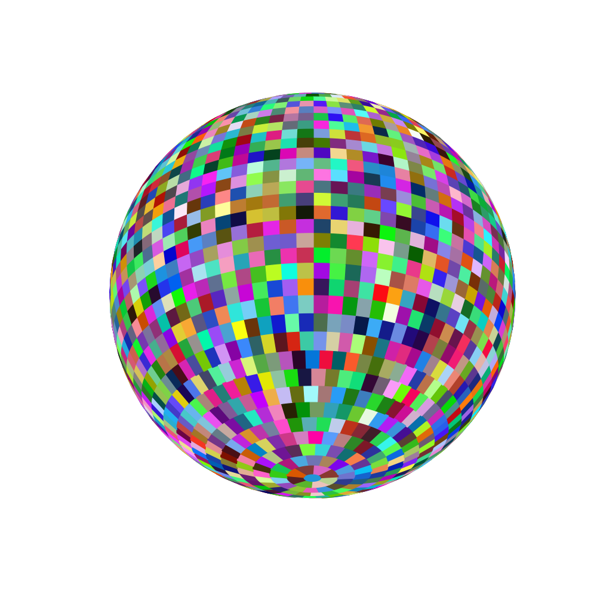
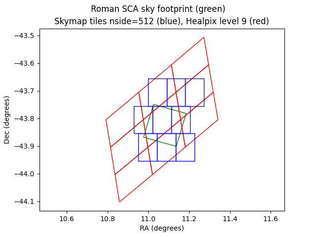
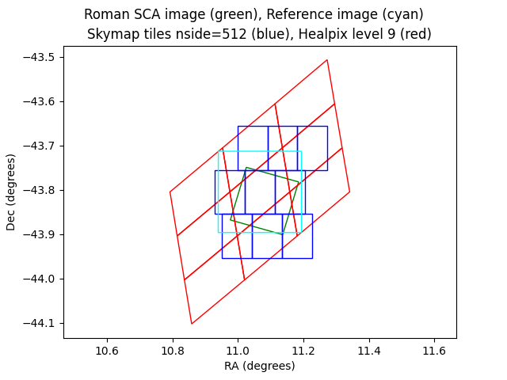
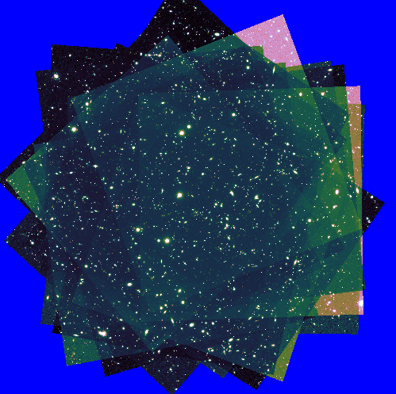
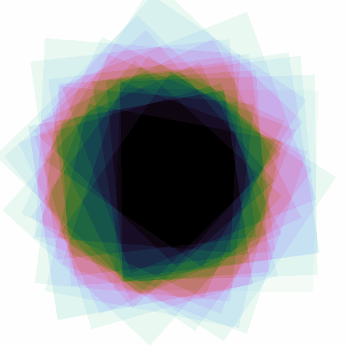
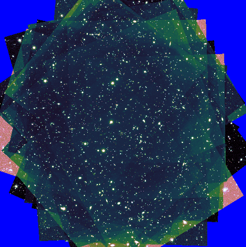
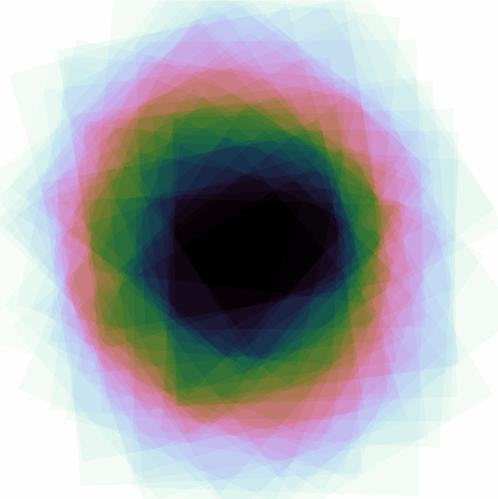
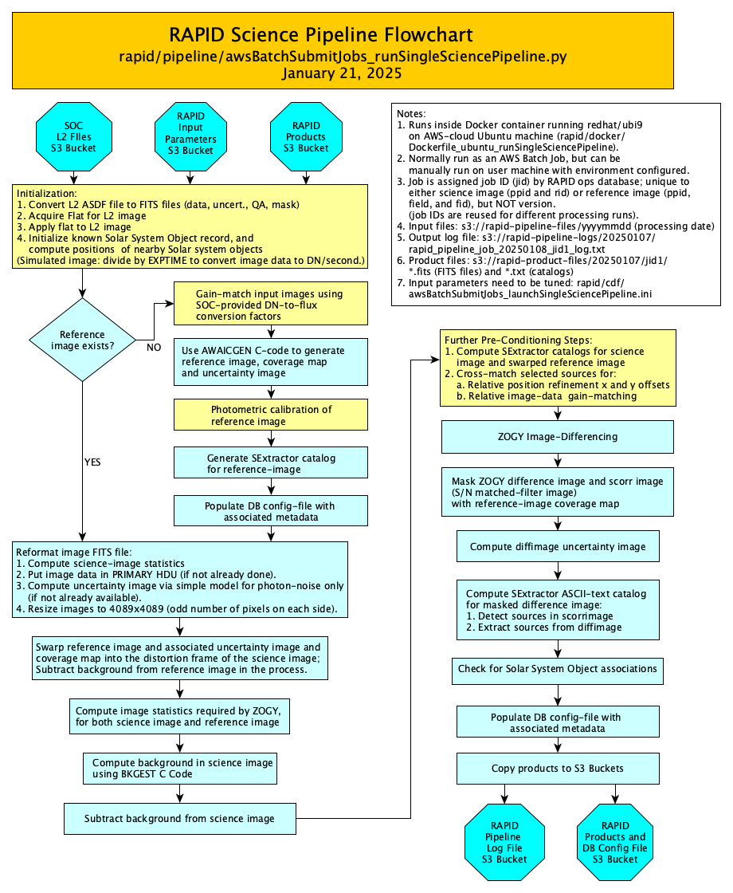

RAPID Pipeline Design
####################################################

Introduction
************************************
Below describes the current design of the RAPID pipeline and its rationale.

The pipeline will interact with the RAPID operations database, most likely in a
loosely coupled way, in order to keep the design flexible and control the number
of simultaneous connections.

.. note::
    The pipeline design described below is evolving and subject to change.

Computer Languages
************************************

The RAPID pipeline is written in Python, with some bash scripts, and system calls to OS commands and C executable binaries.
A few Perl scripts are used to prepare ad-hoc data for database ingestion, etc.

Sky Tiles
************************************

.. warning::
    This section explains the Roman tessellation scheme using large sky tiles, for illustration purposes only
    (large tiles are easier to list and plot).
    Much smaller tiles will be adopted for the RAPID pipeline, as discussed below in the section entitled Reference Images.

Please refer to the `SkyMap GitHub Repository <https://github.com/darioflute/skymap>`_ for the Roman-tessellation source code.
In one implementation of this gridding scheme (for illustrative purposes here), the parameter setting NSIDE=10
yields a sky that is divided into 2402 relatively large tiles, which are, in general,
approximately square and with similar area.
The tiles are basically aligned in rows within declination bins, with the most right-ascension
bins at the equator and progressively fewer as
the poles are approached (see table below).  There is one circular tile capping each pole.
For NSIDE=10, the tile size near the equator is approximately 3.8 degrees in declination height
and 4.5 degrees in right-ascension width.

Table: Number of right-ascension bins per declination bin for NSIDE=10.

==========   =====      ===========
center_dec   count      dec-bin num
==========   =====      ===========
-90.0        1          1
-85.32052    8          2
-80.63321    16         3
-75.93013    24         4
-71.203094   32         5
-66.443535   40         6
-61.642365   48         7
-56.789783   56         8
-51.875088   64         9
-46.886395   72         10
-41.810314   80         11
-36.869896   80         12
-32.230953   80         13
-27.81814    80         14
-23.578178   80         15
-19.47122    80         16
-15.46601    80         17
-11.536959   80         18
-7.662256    80         19
-3.8225536   80         20
0.0          80         21
3.8225536    80         22
7.662256     80         23
11.536959    80         24
15.46601     80         25
19.47122     80         26
23.578178    80         27
27.81814     80         28
32.230953    80         29
36.869896    80         30
41.810314    80         31
46.886395    72         32
51.875088    64         33
56.789783    56         34
61.642365    48         35
66.443535    40         36
71.203094    32         37
75.93013     24         38
80.63321     16         39
85.32052     8          40
90.0         1          41
==========   =====      ===========

These sky tiles are much larger than the Roman WFI focal plane (which is roughly 0.5 degrees by 1.2 degrees with gaps).

Here is a 3-D plot of the Roman tessellation for NSIDE=10:

As will be seen below, it will be necessary to adopt
a tile size that is suitable for Roman SCA images.

Reference Images
************************************

Reference images are needed for image differencing.  The maximum-tolerable number of pixels in a reference image
constrains the footprint of a reference image on the sky.
The reference images will be constructed for sky tiles given by the Roman tessellation scheme.

For the RAPID project, the Roman-tessellation parameter setting NSIDE=512 will be used,
and this will give tile sizes somewhat smaller than that of a Roman SCA image.
This results in 6,291,458 tiles covering the entire sky.
The tile size near the equator, for example, is 0.08789 degrees wide in ra and 0.0746 degrees high in dec.
This is roughly between 66% and 75% of the
width of an SCA, which is approximately 0.12 degrees.  The tile sizes vary over the sky; for example, the height of a dec bin ranges
from approximately 0.075 degrees to 0.1 degrees, and similarly for the widths of ra bins.  There are 2049 dec bins total, and 4096 ra
bins per dec bin near the equator.

The sky tiles of the Roman tessellation are indexed starting with one, and these indexes,
associated with different sky positions, such as the center of a reference image,
are stored in the field column of various tables in the RAPID operations database.
The maximum value of the field or sky-tile index is 6,291,458.

For comparison, here are the sky footprints of a simulated Roman SCA image (Roman_TDS_simple_model_F184_11474_2_lite.fits),
Skymap tiles for NSIDE=512, and Healpix pixels for level=9:

As can be seen in this example, the sky position of the center of the SCA image falls within the central skymap tile.

The reference images will be constructed to have sufficient buffer regions outside of the sky tile to which they are associated,
since a single Roman SCA image may overlap multiple tiles.
The buffer regions will account for arbitrary placement of individual frames relative to tile-center sky positions, and
also for arbitrary pointing roll angles.
Nominally the pixel scale for the reference images
will be the same as individual frames, but the size of reference images will be larger, having ~6Kx6K pixels instead of ~4Kx4K pixels.

Here is the sky footprint of the proposed 6Kx6K-pixel reference image, shown in cyan, for the example given above:

It is possible for the science image, represented in green, to be incompletely covered by the proposed reference image, especially
for cases where the science-image center is far from the tile center and rotated by some odd multiple of 45 degrees.  This
could be remedied by making the reference image bigger (which is done below),
but at a cost of more reference-image pixels to store and process.

Reference images will be constructed for different filters.  For a given filter, images from
different SCAs will be stacked to make reference images.

All reference images will have no rotation and north up.

There ideally should be some minimum observation-time interval between a science image and reference image, so that
transients are actually detectable.

The logic for picking L2 science images as inputs for reference-image generation is located at two places in the RAPID code base:

#. Python script ``pipeline/launchSciencePipelinesForDateTimeRangeWithRefImageWindow.py`` queries the RAPID operations database
   for field/filter combinations that have the minimum number of L2 science images for reference-image generations and processing
   at least one L2 science image through the RAPID Pipeline that is different from the reference-image inputs (currently the
   RAPID pipeline has the optional step of reference-image generation, based on whether or not a reference image already exists,
   before image-differencing a given L2 science image).

#. Method ``get_overlapping_l2files`` in ``database/modules/utils/rapid_db.py`` queries the RAPID operations database
   for all L2 science images that overlap the sky tile associated with the input science image and its filter
   that were acquired before the input science image.

Both of these code locations have special logic to handle reference-image-generation strategies with various complexities for different
simulated datasets, i.e., Open-Universe sims, rimtimsims, and SOC sims.

The following are a 7Kx7K-pixel reference image and its associated coverage map, resulting from the coaddition of 50 input images.
These were generated by ``awaicgen``, which is a C-code module from the WISE mission that was modified to be generic coadder.

Also below are a 7Kx7K-pixel reference image and its associated coverage map, resulting from the coaddition of 100 input images, made by ``awaicgen``.
(The image-display stretches are different for cases with 50 inputs versus 100 inputs.)

.. _refimage-infobits:

Reference-image InfoBits and status
^^^^^^^^^^^^^^^^^^^^^^^^^^^^^^^^^^^^

Every newly generated reference image gets an ``infobits`` bit-flag word and a ``status``, as ZTF
reference images do.  Each InfoBit records one quality condition; the ``status`` is 1 (usable),
or 0 (bad) when any *fatal* bit is set.  They are computed by ``evaluate_refimage_quality`` in
``pipeline/referenceImageSubs.py``, in both the reference-image pipeline
(``awsBatchSubmitJobs_runSingleReferenceImagePipeline.py``) and the science pipeline when it
generates its own reference image (``awsBatchSubmitJobs_runSingleSciencePipeline.py``), after the
reference image's SExtractor and PhotUtils PSF-fit catalogs have been made.  A reference image
taken from the database keeps the InfoBits and status it was registered with.

The bits are defined in ``cdf/infobitsref.txt``.  A bit is set when its condition is met; a metric
that could not be computed (NaN) sets no bit, and comparisons are strict (a value equal to its
threshold sets no bit).  Reference-image pixels are in DN/s at the filter zero point
``zprefimg``, and the pixel scale is read from the reference image's WCS (0.11 arcsec).

.. list-table::
   :header-rows: 1
   :widths: 6 34 40 20

   * - Bit
     - Set when
     - Metric
     - Threshold
   * - 0
     - Median background level > t00
     - ``gmedian`` of the reference image [DN/s]
     - t00 = 1.0 DN/s
   * - 1
     - Robust pixel noise > t01
     - ``datascale`` = 0.5 (p84 - p16) of the reference image [DN/s]
     - t01 = 0.1 DN/s
   * - 2
     - Percent of bad/saturated pixels > t02
     - NaN pixels with coverage > 0, plus saturated pixels, as a percentage of the pixels with
       coverage > 0
     - t02 = 65 %
   * - 3
     - Point-source FWHM > t03
     - Mode of ``FWHM_IMAGE`` over the point sources of the reference-image SExtractor catalog
       (median fallbacks when there are few point sources), times the pixel scale
     - t03 = 1.0 arcsec
   * - 4
     - Percentile of point-source FWHM > t04
     - ``fwhm_percentile`` (90th) percentile of ``FWHM_IMAGE`` over the same sources
     - t04 = 2.0 arcsec
   * - 5
     - Limiting magnitude from the PSF-fit catalog < t05
     - ``zprefimg`` - 2.5 log10(``maglim_snr`` x median ``flux_err``) of the PhotUtils catalog
     - t05 = 15.0 mag
   * - 6
     - Limiting magnitude from the image noise < t06
     - ``maglim_snr``-sigma point-source limit from the background noise and the PSF noise
       pixels (``compute_limiting_magnitude_for_l2_image``)
     - t06 = 15.0 mag
   * - 7
     - Number of PSF-fit catalog sources < t07
     - Rows of the PhotUtils catalog (0 if it could not be made)
     - t07 = 10
   * - 8
     - Number of SExtractor catalog sources < t08
     - Rows of the SExtractor catalog
     - t08 = 10
   * - 9
     - Reserved
     - (ZTF: median number of input photometric-calibration matches; RAPID has none)
     -
   * - 10
     - Robust spread of the input zero points > t10
     - 0.5 (p84 - p16) of the input images' ``ZPTMAG``
     - t10 = 3.5 mag
   * - 16
     - PSF-fit catalog not possible
     - The PhotUtils PSF-fit catalog could not be made
     -

The bits follow ZTF's, with these differences: bit 2 counts only the pixels with coverage, since
the reference-image mosaic is NaN outside the area its input images cover; bits 3 and 4 use the
reference image's own SExtractor catalog, since RAPID does not record the seeing of the input
images; and bit 4 uses a percentile rather than ZTF's maximum, since the largest FWHM in the
catalog is that of a galaxy or blend.

The thresholds, ``fwhm_percentile``, ``maglim_snr``, and the fatal bits are set in the
``[REFIMAGE_INFOBITS]`` section of ``cdf/awsBatchSubmitJobs_launchSingleSciencePipeline.ini``,
which the reference-image and science pipeline launchers copy into each job's configuration
(the values above are used if it is missing).  The fatal bits are 2, 5, 7, 8 and 16, as for ZTF.
The thresholds are provisional: where the units are those of ZTF (percent, numbers of sources,
magnitudes of zero-point spread) they are ZTF's, and the others are set loose enough that a
normal reference image raises no bit.  They are to be tuned on real data; every job log prints
the metrics as ``Reference-image QA metrics: {...}``, followed by the InfoBits and status.

The InfoBits and status are recorded in:

* the ``infobits`` and ``status`` columns of the ``RefImages`` database record, through the
  product configuration file;
* the reference image and its uncertainty image, as FITS keywords ``INFOBITS`` and ``STATUS``,
  with a ``BITnn`` keyword for each bit in use whose comment is its definition with the
  threshold filled in (see :doc:`../prod/products`).  As for ZTF, the comment of ``INFOBITS``
  lists the bits that are set (``bit(s) = none`` if none is).  For example, a reference image
  with bits 4 and 9 set has

  .. code-block::

      INFOBITS=                  528 / infoBits string; bit(s) = 4, 9
      STATUS  =                    1 / Overall quality: 1 = usable, 0 = bad
      BIT00   =                    0 / MEDIAN BACKGROUND LEVEL is > 1.0 DN/s
      BIT01   =                    1 / ROBUST PIXEL NOISE (RMS) is > 0.10 DN/s
      BIT02   =                    2 / PERCENT OF BAD/SATURATED PIXELS is > 65.0%
      BIT03   =                    3 / MEDIAN OF SOURCE FWHM is > 1.00"
      BIT04   =                    4 / 90TH PCTILE OF SOURCE FWHM is > 2.00"
      BIT05   =                    5 / MAGLIM FROM PSF CATALOG UNCERTS is < 15.0 mag
      BIT06   =                    6 / MAGLIM FROM EMPIRICAL FORMULA is < 15.0 mag
      BIT07   =                    7 / NUMBER OF PSF CATALOG SOURCES is < 10
      BIT08   =                    8 / NUMBER OF SEXTRACTOR CAT SOURCES is < 10
      BIT10   =                   10 / ROBUST RMS OF INPUT IMAGE ZPs is > 3.50 mag
      BIT16   =                   16 / PSF-FIT CATALOG NOT POSSIBLE

  The post-processing pipeline rewrites ``INFOBITS`` from the ``RefImages`` record, with the
  same comment, so reference images made before the comment was introduced get it too.

.. note::
   A reference image with ``status = 0`` is not used: the database query for the best reference
   image of a field and filter selects only ``status > 0``.  The next reference-image launch, or
   the science pipeline, will therefore generate it again from the same inputs, most likely with
   the same result.  Tighten the thresholds or add fatal bits only after checking the metrics on
   real reference images.

Image Differencing
************************************

The RAPID pipeline makes difference images with SFFT, and optionally with ZOGY (``[ZOGY] run_zogy``) and by naive
subtraction (``[NAIVE_DIFFIMAGE] naive_diffimage_flag``).  Only the SFFT difference image is registered in the
database and used downstream (see :doc:`../prod/products`).  The rest of this section was written for ZOGY, but the
input requirements apply to SFFT as well.

An implementation of the ZOGY algorithm was originally planned for image differencing in the RAPID pipeline.  ZOGY requires
the input images to be gain-matched and resampled to the same grid frame of reference in terms of pixel scale,
position, and orientation.  The input science image can be arbitrarily rotated on the sky, whereas the
input reference image is constructed to be north up (zero degrees rotation on the sky), and centered on
the closest predefined field (associated with the relevant Roman tessellation index).
Image resampling is therefore necessary.
``SWarp`` can be used to resample the reference image into the distorted grid of the science image.
In cases where the reference image consists of too few coadded inputs for undersampling to be resolved, it may be
necessary to instead use ``awaicgen`` to resample the science image into the undistorted grid of the reference image
(``awaicgen`` does not produce coadds mapped into distorted grids).

Point Spread Functions (PSFs)
^^^^^^^^^^^^^^^^^^^^^^^^^^^^^

PSFs are required by the ZOGY algorithm.  In fact, it requires both the PSF of input science image
and the PSF of the reference image.

Reference images are averages of arbitrarily rotated input images from different SCAs for the same filter.
Therefore, the reference-image PSF should be axially symmetric, the average of all 18 SCAs in a given filter, and
PSF values should depend only on the radius from the PSF center.  The reference-image PSF should be renormalized.
This approach sidesteps the inherent trickiness of determining whether a PSF should be flipped before applying.
(Is the WCS of the reference image configured to view the image from inside or outside the celestial sphere?
What about the PSF?  It is difficult to know whether you got it correct, since the smeared data are so featureless).
Averaging over all pixels at the same radial distance from the reference-image PSF center is robust and a reliable
compromise to a solution in which only one science-image PSF and only one referenced-image is provided to the
ZOGY software for image differencing.  If the science image and reference image are segmented, then appropriately
different PSFs can be supplied as inputs, but this will require more computing and will complicate the RAPID pipeline,
so it will be deferred until later (if ever implemented at all).

Depending on the survey strategies, the utilization averaged, symmetric PSFs may not work well in some cases.
Especially for the Galactic Bulge, where campaigns will be composed of many sequenced images with only small
dithers at the same orientation.  The simplest possible alternative to the aforementioned general PSF approach
is to average the PSFs using the same set of rotations and SCAs used by the reference image.  This will be
considered as a possible upgrade to the RAPID pipeline, if resources allow.

Science Pipeline Flowchart
**************************

Here is a flowchart of the RAPID science pipeline:

The pipeline is coded in Python and C, and runs inside the RAPID-pipeline docker container, in which all required software is preinstalled.
